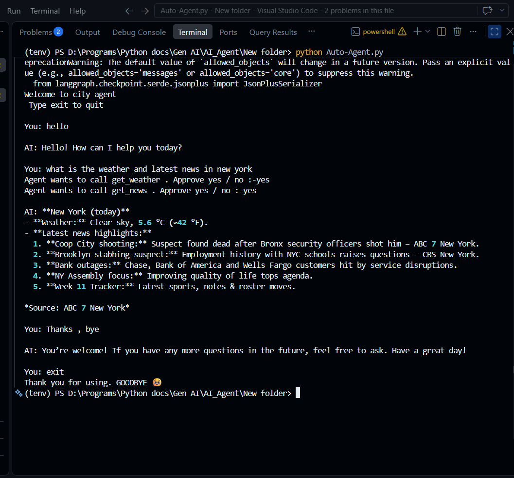
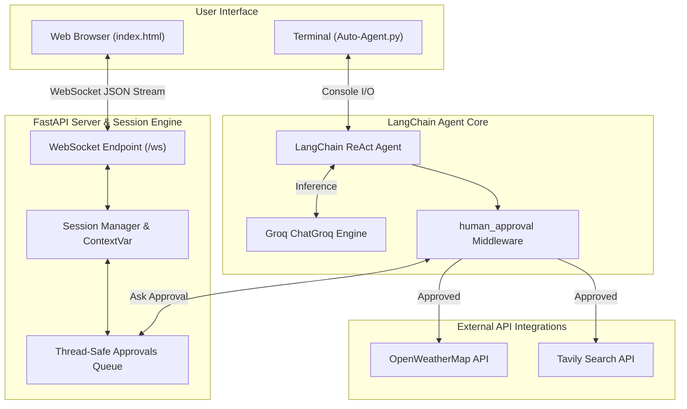
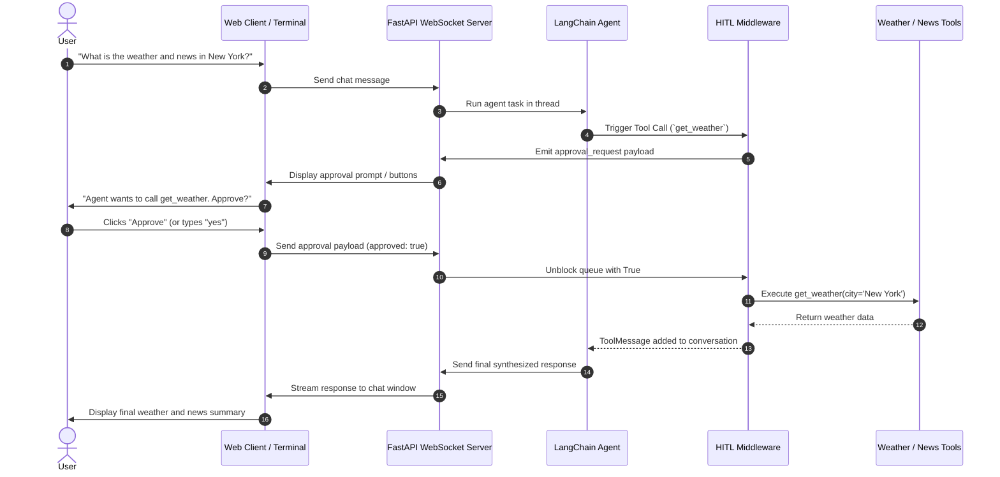
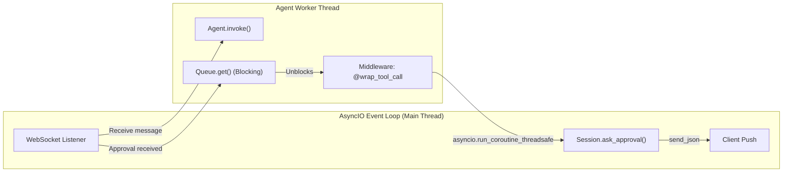

# 🌆 City Intelligence AI Agent (with Human-in-the-Loop)

[](https://www.python.org/)
[](https://fastapi.tiangolo.com/)
[](https://www.langchain.com/)
[](https://groq.com/)
[](https://tavily.com/)
[](LICENSE)

An intelligent, multi-tool conversational AI Agent that delivers real-time weather metrics and breaking news for any city globally. Built with **LangChain**, **Groq**, **OpenWeatherMap**, **Tavily**, and **FastAPI**, featuring a robust **Human-in-the-Loop (HITL)** safeguard mechanism that requires explicit human authorization before executing external tool calls.

---

## 📸 Console Output & Execution Proof

Here is the CLI Agent executing live, demonstrating dynamic tool invocation (`get_weather` & `get_news`) with interactive human approval:



> **Execution Highlights:**
> 1. User asks for weather and latest news in New York.
> 2. Agent detects tool requirements and pauses for human verification (`Approve yes / no`).
> 3. Upon approval, it fetches live data from OpenWeatherMap and Tavily APIs.
> 4. Synthesizes a structured, concise response with source citations.

---

## 🌟 Key Features

- **🛡️ Human-in-the-Loop (HITL) Guardrails:** Protects against unintended API calls, quota exhaustion, and hallucinations by asking for user authorization before invoking any tool.
- **⚡ Dual Execution Modes:**
  - **🖥️ Terminal / CLI Mode (`Auto-Agent.py`):** Interactive shell chat with command-line confirmation prompts.
  - **🌐 Full-Stack Web Mode (`app.py`):** Real-time web chat powered by FastAPI and WebSockets, rendering interactive Approval Action Cards (`Approve` / `Reject`) directly in the browser.
- **🌤️ Live Weather Data:** Instant temperature, condition reports, and weather descriptions via OpenWeatherMap.
- **📰 Curated City News:** Real-time search and article aggregation via Tavily AI Search API with direct source links.
- **🚀 Ultra-Fast Inference:** Powered by Groq's high-speed inference engine running open-source models (`openai/gpt-oss-20b` or `qwen/qwen3.8-27b`).
- **🧵 Asynchronous Thread-Safe Architecture:** Bridges FastAPI's async event loop with LangChain's synchronous worker execution using Python `contextvars` and thread-safe queues.

---

## 🏗️ System Architecture

### 1. High-Level Architecture Flow



---

### 2. Human-in-the-Loop (HITL) Sequence Diagram



---

### 3. Asynchronous Worker & Session Bridge



---

## 📂 Project Directory Structure

```plaintext
AI_Agent/
├── .env                  # Private API keys (keep secure!)
├── .env.example          # Environment variables template
├── .gitignore            # Git exclusion rules
├── app.py                # FastAPI Web application with WebSockets & HITL
├── Auto-Agent.py         # Standalone CLI agent with terminal HITL
├── console-output.png    # Live execution console screenshot
├── index.html            # Web interface (Dark/Light mode, Chat & Approvals)
├── static/
│   └── index.html        # Static build assets for FastAPI
├── requirements.txt      # Project Python dependencies
└── README.md             # Project documentation
```

---

## 🚀 Getting Started

### 1. Prerequisites
- Python **3.10+** (Python 3.10 or 3.11 recommended)
- Git installed on your system

### 2. Clone the Repository
```bash
git clone https://github.com/your-username/city-intelligence-agent.git
cd city-intelligence-agent
```

### 3. Create and Activate a Virtual Environment

**Using `conda`:**
```bash
conda create -n cityagent python=3.10 -y
conda activate cityagent
```

**Using `venv`:**
```bash
python -m venv venv
# Windows:
venv\Scripts\activate
# macOS/Linux:
source venv/bin/activate
```

### 4. Install Dependencies
```bash
pip install -r requirements.txt
```

### 5. Configure API Keys
Create a `.env` file in the root directory (or copy from `.env.example`):
```bash
cp .env.example .env
```

Edit `.env` with your API credentials:
```env
# Groq Cloud API Key (https://console.groq.com/)
GROQ_API_KEY=gsk_your_groq_api_key_here

# OpenWeatherMap API Key (https://openweathermap.org/api)
OPENWEATHER_API_KEY=your_openweathermap_api_key_here

# Tavily AI Search API Key (https://tavily.com/)
TAVILY_API_KEY=tvly-your_tavily_api_key_here
```

---

## 💻 Running the Application

### Option A: Web Application Mode (Interactive Web UI)

Start the FastAPI application with auto-reload:
```bash
python app.py
```
*Or using Uvicorn directly:*
```bash
uvicorn app:app --host 127.0.0.1 --port 8000 --reload
```

Open your browser and navigate to:
```
http://127.0.0.1:8000
```

> **Web UI Capabilities:**
> - Clean modern chat interface with auto-scrolling.
> - Live connection status indicator.
> - Tool approval cards displaying the tool name and arguments with instant **Approve** and **Reject** buttons.
> - Markdown formatting for structured news and weather insights.

---

### Option B: Terminal / CLI Mode

If you prefer a lightweight terminal experience without running a web server:
```bash
python Auto-Agent.py
```

Type `exit` anytime to end the session.

---

## 🧠 Technical Deep-Dive

### Why Human-in-the-Loop (HITL)?
Autonomous agents can occasionally generate tool calls with malformed arguments, call costly endpoints repeatedly, or access restricted tools unexpectedly. 

By wrapping tool executions with `@wrap_tool_call`:
```python
@wrap_tool_call
def human_approval(request, handler):
    tool_name = request.tool_call["name"]
    session: Session = _current_session.get()
    approved = session.ask_approval(tool_name, request.tool_call.get("args", {}))
    if not approved:
        return ToolMessage(
            content=f" The user doesn't approve the {tool_name} tool",
            tool_call_id=request.tool_call["id"]
        )
    return handler(request)
```
- If **Approved**: The underlying handler executes the API call and feeds the output back into the conversation context.
- If **Rejected**: A synthetic `ToolMessage` informs the LLM that the human rejected the call, allowing the agent to gracefully adapt its response without crashing or retrying indefinitely.

### Async-to-Sync Queue Synchronization
FastAPI runs on an asynchronous event loop (`asyncio`), whereas LangChain tools often invoke synchronous I/O or libraries. The application uses Python's `contextvars.ContextVar` to associate the active WebSocket session per thread and uses `queue.Queue` with `asyncio.run_coroutine_threadsafe` to cleanly pause the agent worker thread while awaiting human button clicks from the browser.

---

## 🛠️ Tech Stack & Integrations

| Layer | Technology | Purpose |
|---|---|---|
| **Language** | Python 3.10+ | Core application logic |
| **LLM Provider** | Groq Cloud | Ultra-low latency model inference |
| **Agent Framework** | LangChain / LangGraph Checkpoint | Tool binding, ReAct orchestration & middleware |
| **Web Server** | FastAPI & Uvicorn | Async WebSocket communication and HTTP routing |
| **Search Engine** | Tavily AI | Accurate, real-time news extraction |
| **Weather API** | OpenWeatherMap | Global real-time weather metrics |
| **Frontend** | Vanilla JS & HTML5 | Lightweight, dependency-free responsive interface |

---

## 🤝 Contributing

Contributions, issues, and feature requests are welcome!
Feel free to open an issue or submit a Pull Request.

1. Fork the Project
2. Create your Feature Branch (`git checkout -b feature/AmazingFeature`)
3. Commit your Changes (`git commit -m 'Add some AmazingFeature'`)
4. Push to the Branch (`git push origin feature/AmazingFeature`)
5. Open a Pull Request

---

## 📄 License

Distributed under the MIT License. See `LICENSE` for more information.
